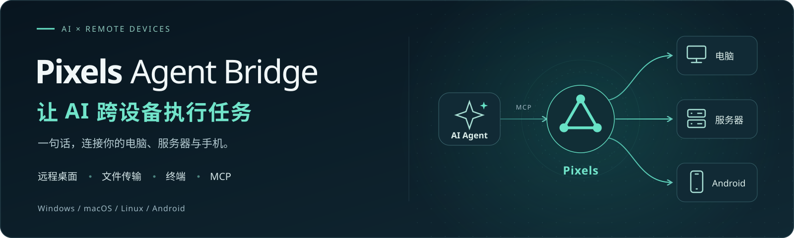
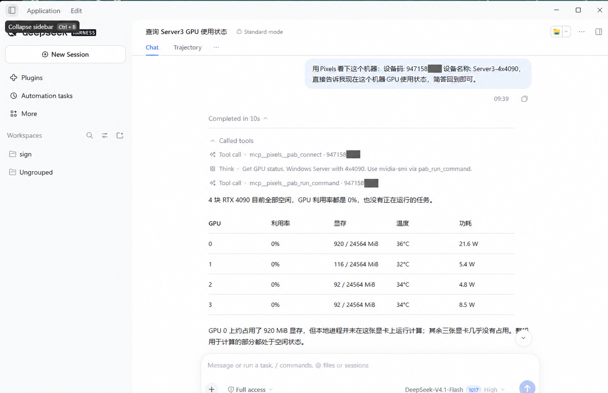
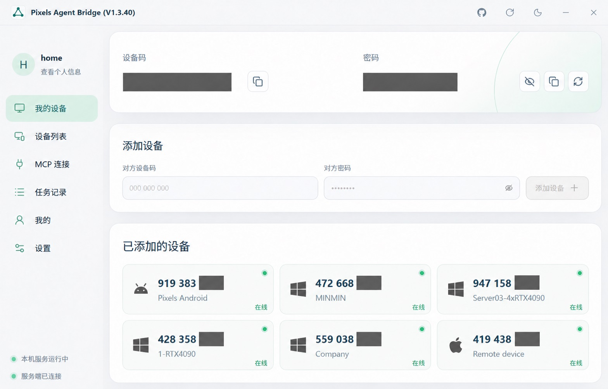
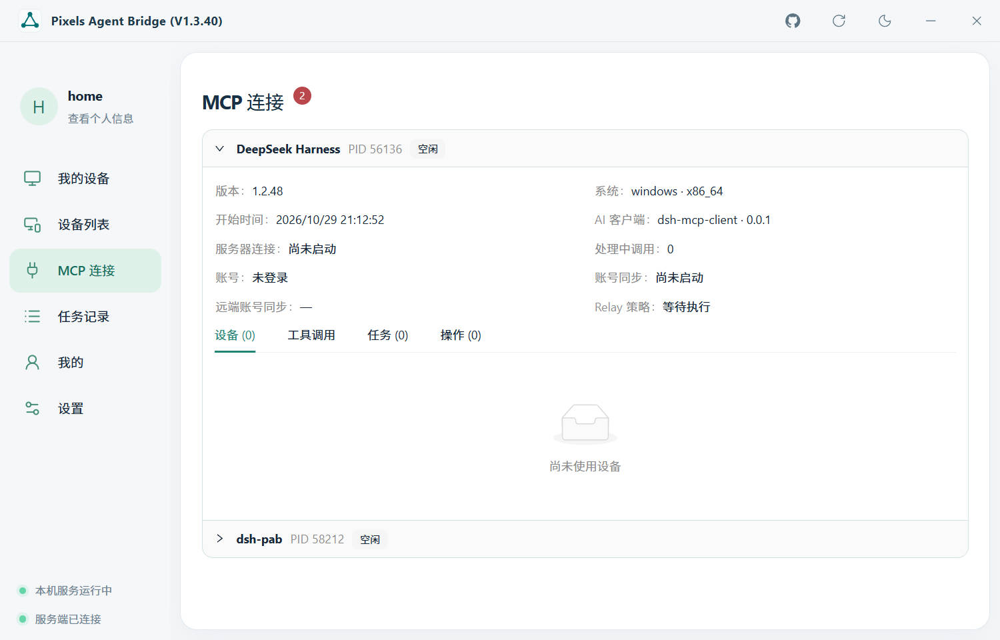
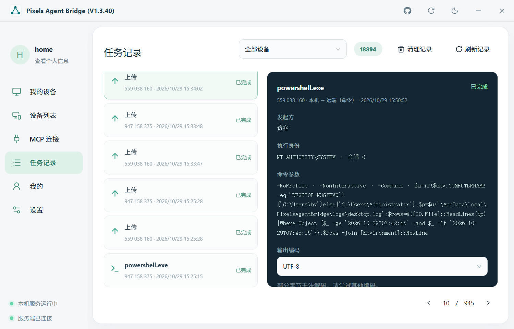
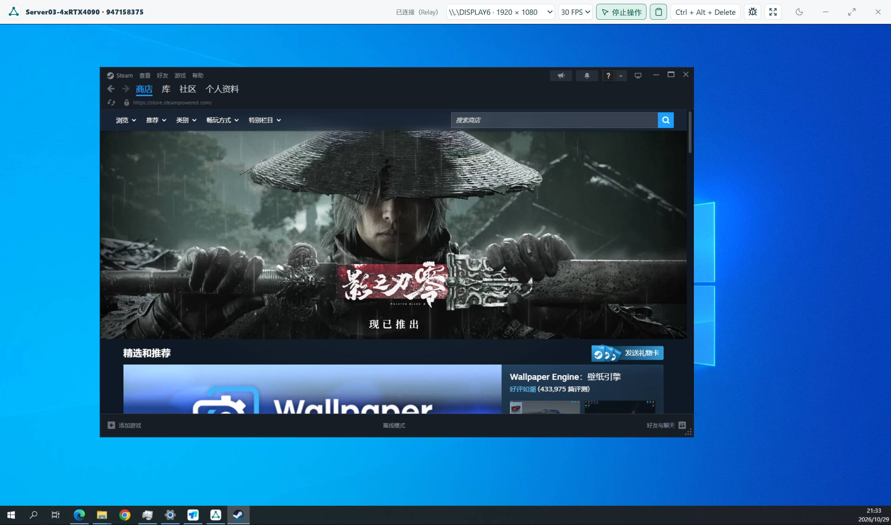
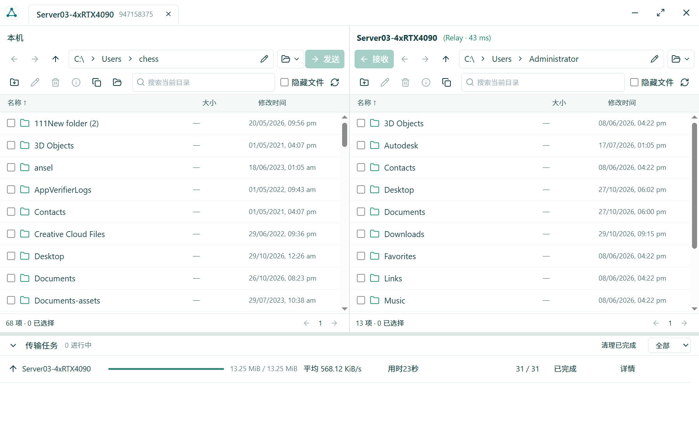
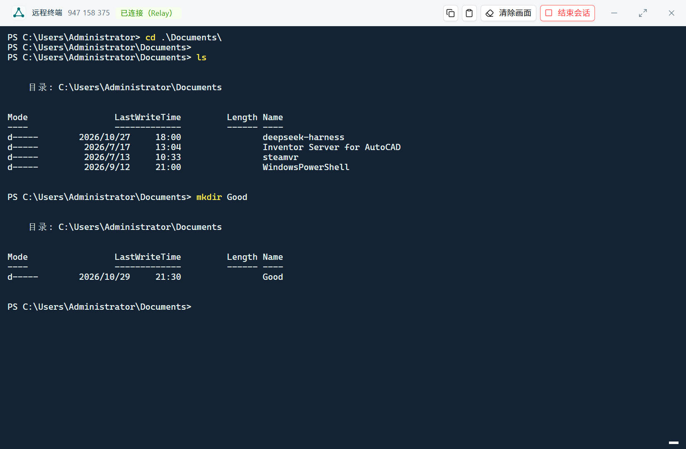
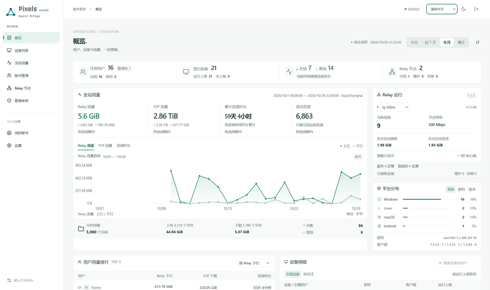

# Pixels Agent Bridge

> **注意：** 我们提供免费 Relay 服务，如果想获得更快的速度，请您自行部署 Relay 服务。

**让 AI Agent 通过网络操作你的设备。**

简体中文 · [English](README.en.md)

Pixels Agent Bridge 通过 MCP 将 AI Agent 与计算机、Android 设备连接起来。用自然语言跨设备执行命令、管理文件、查询系统和操作应用；需要人工处理时，也可以直接打开远程桌面或终端接手。

## 能做什么

- **远程桌面**：独立窗口查看画面，支持切换屏幕、鼠标键盘、全屏及文字／PNG 图片剪贴板同步。可选 15／30／60 FPS 上限，默认 30 FPS；使用本机指针并同步远端样式。默认只查看，已占用会话需明确确认后才能接管。
- **命令与终端**：运行程序、使用独立交互式终端窗口、查看任务输出；Windows 在支持的环境下提供 System 终端。
- **文件操作**：独立双栏文件传输窗口，支持设备标签页、文件／文件夹传输、进度、速度和用时展示。同名冲突可选择替换、跳过或保留两者，并将选择用于本次传输后续冲突。MCP 也支持文件搜索、编辑、复制和压缩。
- **桌面自动化**：在 Windows、macOS 上获取 JPEG 截图、查询窗口与 UI 控件、发送键鼠输入。
- **系统与开发工具**：查询系统资源、进程和网络，执行平台支持的服务管理、Git 和 Docker 操作。
- **文档与浏览器**：提取和搜索文档、渲染支持的格式、离线 OCR，以及操作 Pixels 启动的浏览器。Agent 遇到需要人工处理的环节时可以请求协助。
- **Android 被控端**：在系统授权范围内提供无障碍界面操作、截图、文件、应用、通知、命令和网络工具。电脑上的文件传输与终端窗口可使用手机应用自身身份和已授权访问范围，不提供 Root 或 ADB shell 权限。
- **桌面管理**：管理设备、查看本地任务记录和各 Agent 的 MCP 连接。支持简体中文、英文及亮暗主题。
- **账号与 Web 后台**：登录、管理用户和设备，设置 Relay 节点容量、监控连接、维护节点及停用／恢复。任务记录只保存在本地，不上传服务端。

Desktop 启动时自动检测并接入已安装的 **Codex、Kimi Code、Claude Code、DeepSeek Harness、OpenCode**。未安装的直接跳过，保留已有配置，主动关闭的接入不会重新开启。其他客户端及无界面安装可手动配置 stdio MCP。

完整流程与平台限制见[功能与使用说明](docs/FIRST_VERSION.md)。本文描述当前源码，已安装软件提供的功能以对应发行包为准。

## 产品一览

点击截图可查看原图。

### 真实使用场景

让 DeepSeek Harness 通过 Pixels 查询远程设备的 GPU 使用状态。

[](assets/images/cn/ds-install-cn.png)

### 桌面端概览

[](assets/images/cn/main-cn.jpg)

### MCP 连接

查看 Agent 会话与工具调用

[](assets/images/cn/mcp-cn.jpg)

### 任务记录

回看本地任务记录

[](assets/images/cn/activity-cn.jpg)

### 远程桌面

查看画面与接手操作

[](assets/images/cn/remote-cn.jpg)

### 文件传输

浏览文件与跟踪传输

[](assets/images/cn/ft-cn.jpg)

### 远程终端

交互式执行远程命令

[](assets/images/cn/terminal-cn.jpg)

### Web 管理后台

管理设备、流量与 Relay

[](assets/images/cn/pab-cn.jpg)

## 支持平台

| 平台 | 提供的组件 |
|---|---|
| Windows | 桌面应用、后台设备服务、MCP |
| macOS | 桌面应用、后台设备服务、MCP |
| Linux 桌面 | Ubuntu 22.04 x86_64 桌面应用、后台设备服务、MCP |
| Linux 无界面 | x86_64 设备服务和 MCP，glibc 2.31+；基础工具无需图形会话 |
| Android | Android 9+ 被控应用；操作端 Desktop／MCP 运行在计算机上 |

远程桌面的查看与控制由 Windows、macOS、Linux 桌面组件提供。锁屏／登录界面访问取决于辅助服务、系统、会话和权限，不绕过系统登录；macOS 需要屏幕录制与辅助功能授权。Android 不提供桌面查看窗口。详见[平台与边界](docs/FIRST_VERSION.md#平台与边界)。

## 快速开始

1. **安装并登录**：在操作端和目标设备安装对应平台的包，使用同一个控制服务，在操作端登录账号。从[统一 GitHub Release](https://github.com/PixelsCloud/PixelsAgentBridge/releases/latest)下载，安装说明见[桌面安装包](packaging/desktop/README.md)、[Linux 桌面版](packaging/desktop/linux-desktop/README.md)和 [Linux 无界面版](packaging/desktop/unix/INSTALL-LINUX.txt)。
2. **保存设备连接**：在目标应用查看九位设备码和密码；Linux 无界面版使用 `show-access`。在操作端输入并成功连接一次，之后 MCP 会使用保存的凭据。
3. **使用 Agent**：Desktop 自动配置检测到的受支持客户端，新建 Agent 会话或重启客户端以加载 MCP。「设置 → AI Agent」可查看、修复或关闭接入；运行中的会话显示在「MCP 连接」页。Linux 无界面版需手动注册 MCP。
4. **直接交代任务**：

   > 用 Pixels 连接设备 123456789，检查它的操作系统和磁盘剩余空间，并总结结果。

发起控制的 Desktop／MCP 必须登录账号才能添加和控制设备，请先在 Desktop 注册或登录。被控设备可不登录账号，以无人值守服务运行。登录后保持登录状态，主动退出才注销。已经运行的 MCP 会自动同步账号变化。用户登录不能代替目标设备密码。

启用 GitHub 登录的服务可直接点击**「使用 GitHub 登录」**，无需另填注册表或设置密码，首次授权会自动创建普通账号。已有账号可以在「我的」中绑定 GitHub。自部署请配置自己的 [GitHub App](docs/GITHUB_LOGIN_SETUP.md)。

## 工作方式

[](diagram/workflow/agent-workflow.svg)

[打开动态流程图](diagram/workflow/agent-workflow.svg)

Agent 调用本地 MCP，由 MCP 连接目标设备的 Executor。控制服务负责设备发现和认证，操作数据优先通过 P2P 传输，无法直连时使用 Relay 中继。

每个 MCP 独立维护连接，Desktop 汇总活动状态并展示本地任务记录。同一被控设备同时只允许一个远程桌面查看者；支持接管的版本可由已认证的操作端明确确认后断开原查看者并接管。同时修改同一文件或操作同一桌面时仍需协调。远程桌面沿用现有可靠传输和设备认证。

## 构建与自部署

桌面端使用 **Rust + Tauri + React + Ant Design**；Web 后台使用 **React + Ant Design**，服务端由 Rust、PostgreSQL 和 Relay 组成。

准备好[构建环境](BUILDING.md)后，在仓库根目录生成 Windows Release 安装包：

```powershell
npm --prefix apps/desktop ci
python scripts/build.py desktop --profile release --package
```

产物位于 `.build/packages/`。安装包版本自动递增，内部组件版本独立维护，构建会复用缓存。

自部署请按 [Web 部署指南](docs/WEB_DEPLOYMENT.md)和 [Docker Compose 说明](packaging/docker/README.md)配置。管理平台（Server + Web）、Relay 和客户端分别计版本，在同一个 [GitHub Release](https://github.com/PixelsCloud/PixelsAgentBridge/releases/latest) 下载。客户端填写配套的控制与 Relay 地址后使用自建服务，覆盖编译默认值。自有程序配置统一使用 TOML；服务切换和 Relay CA 的规则见[配置参考](docs/CONFIGURATION.md)。

## 更多文档

- [功能与使用说明](docs/FIRST_VERSION.md)
- [使用指南与自我部署](docs/USAGE_AND_SELF_HOSTING.md)（与官网文档同步维护）
- [构建与版本规则](BUILDING.md)
- [安装包发布与在线更新](docs/RELEASE.md)
- [配置参考](docs/CONFIGURATION.md)
- [Relay 集群运维](docs/RELAY_CLUSTER_OPERATIONS.md)
- [文档解析与 OCR](docs/DOCUMENTS.md)
- [浏览器自动化](docs/BROWSER_AUTOMATION.md)
- [AI 远程桌面人工协助](docs/REMOTE_DESKTOP_ASSISTANCE.md)
- [Android 被控端](apps/android/README.md)
- [开发说明](BUILDING.md#development)

## 许可证

项目自有代码采用 [PolyForm Noncommercial License 1.0.0](LICENSE)。超出该许可证
允许用途的商业使用，必须事先取得单独书面授权；这包括以商业目的用于企业内部业务。
标准条款对教育、公益、公共研究和政府等列明机构的许可范围保持不变。
详情见[商业授权说明](COMMERCIAL_LICENSE.md)，联系邮箱：
[pixels.save@gmail.com](mailto:pixels.save@gmail.com)。

本项目属于源码可用（source-available）软件。第三方组件保留各自的许可证与声明，
参见 [NOTICE](NOTICE) 及各组件附带的许可文件。

遇到问题可[提交 Issue](https://github.com/PixelsCloud/PixelsAgentBridge/issues)，附上系统、复现步骤和去除凭据后的日志。
