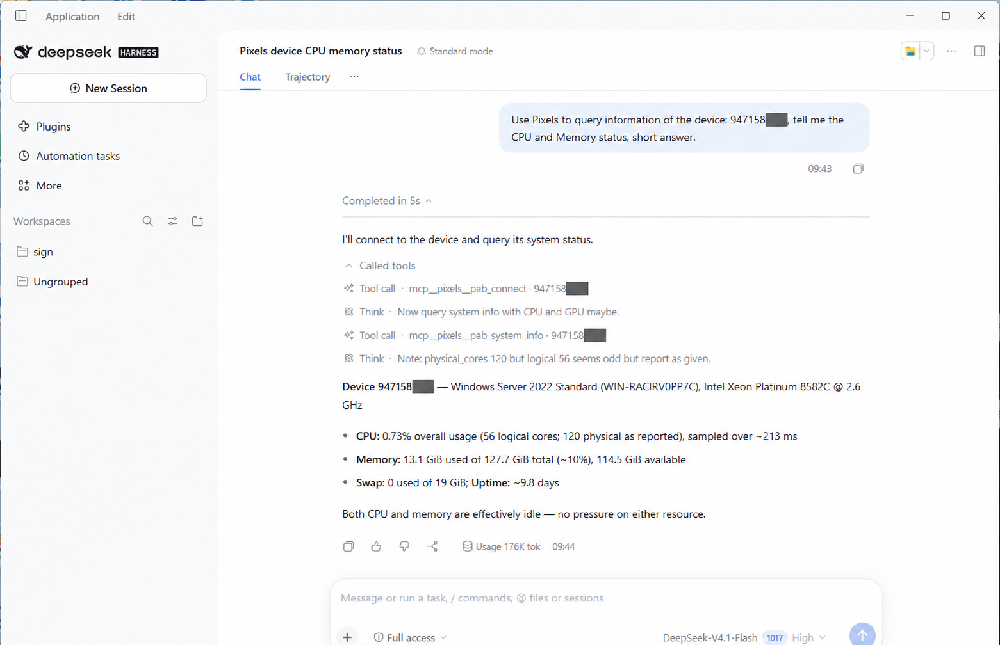
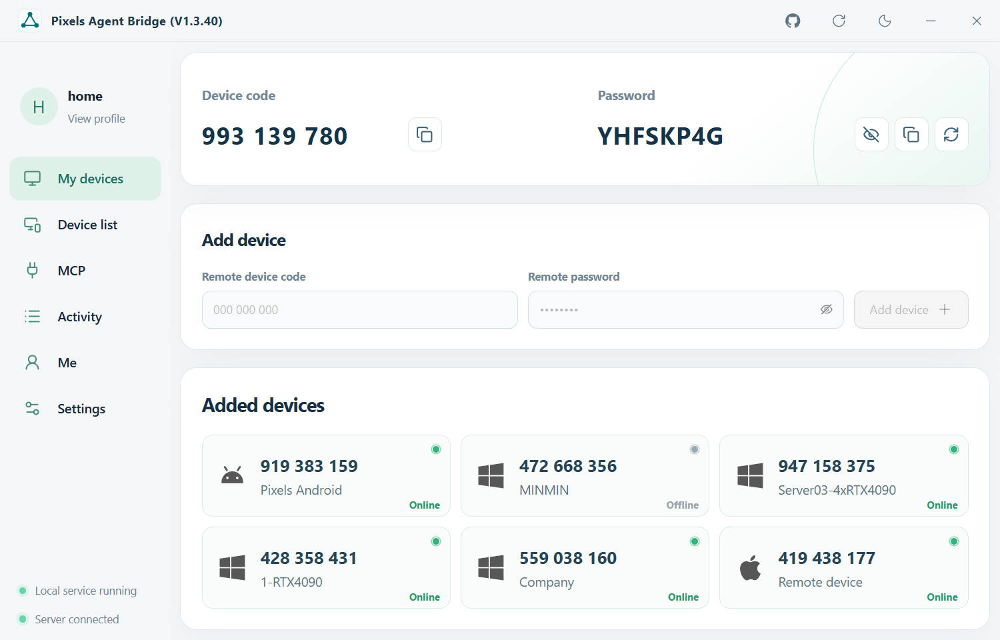
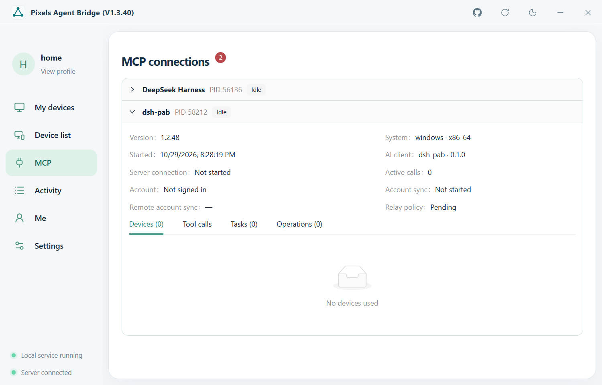
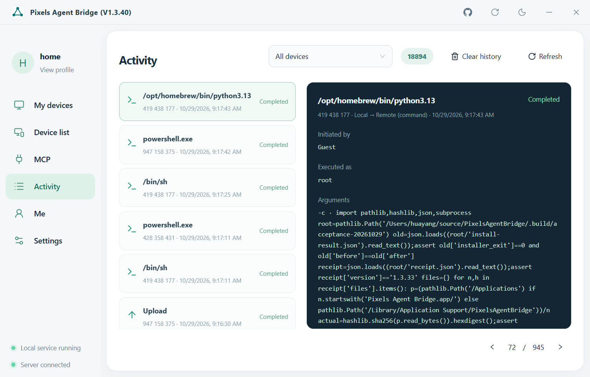
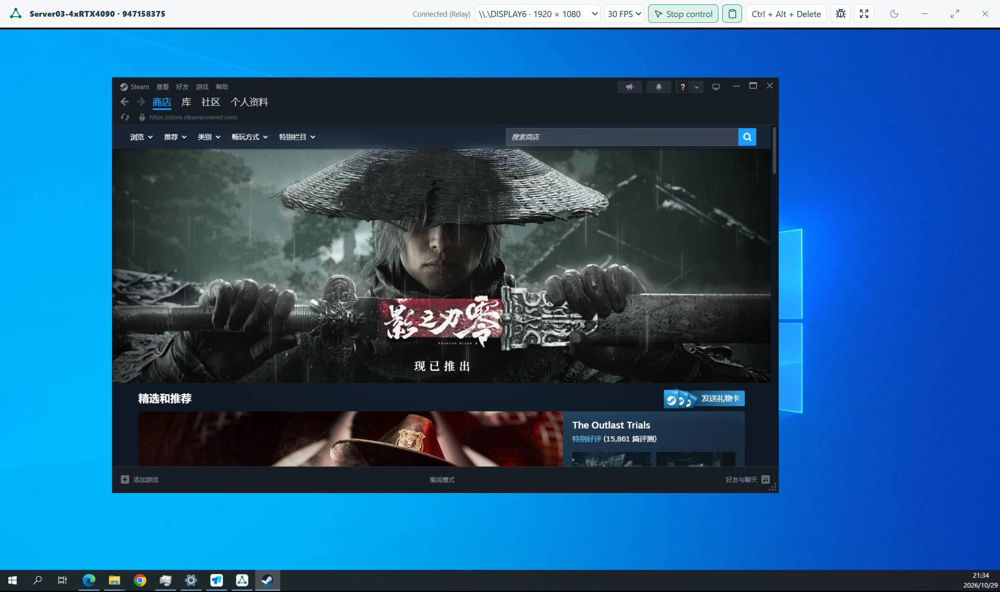
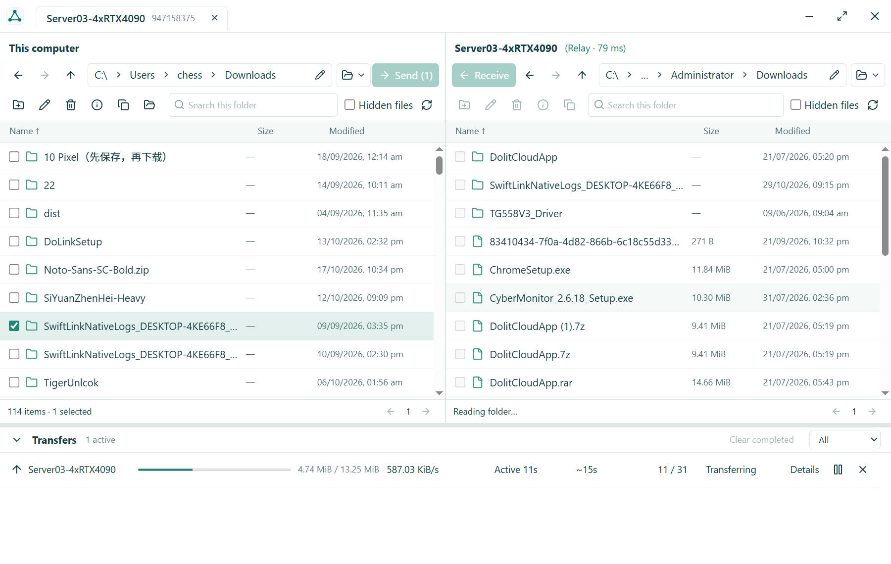
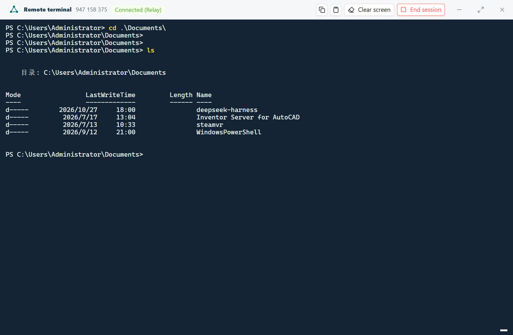
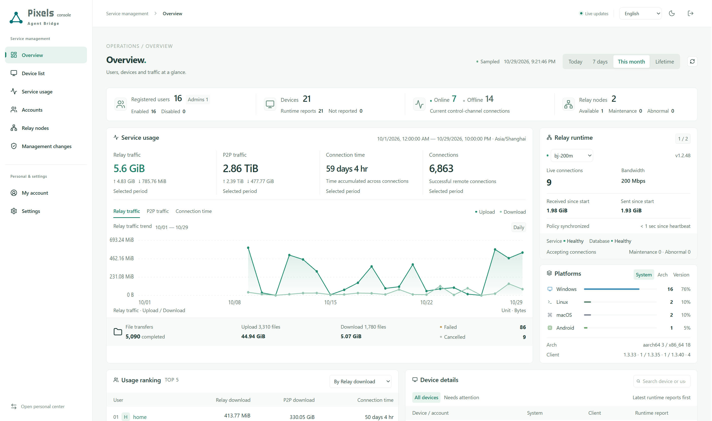

# Pixels Agent Bridge

> **Note:** We provide a free Relay service. For faster speeds, please deploy your own Relay service.

**Control your devices remotely with your AI agent.**

English · [简体中文](README.zh-CN.md)

Pixels Agent Bridge connects AI agents to computers and Android devices through MCP. Use natural language to run commands, manage files, inspect systems, and operate applications across devices. Open a remote desktop or terminal yourself when a task needs hands-on help.

## Product at a glance

Click any screenshot to view it at full size.

### In action

Ask DeepSeek Harness to check a remote device's CPU and memory usage through Pixels.

[](assets/images/en/ds-install-en.png)

### Desktop overview

[](assets/images/en/main-en.jpg)

<table>
  <tr>
    <th width="50%">MCP connections</th>
    <th width="50%">Activity history</th>
  </tr>
  <tr>
    <td align="center">Agent sessions and tools</td>
    <td align="center">Local task history</td>
  </tr>
  <tr>
    <td width="50%" valign="top"><a href="assets/images/en/mcp-en.jpg"></a></td>
    <td width="50%" valign="top"><a href="assets/images/en/activity-en.jpg"></a></td>
  </tr>
  <tr>
    <th width="50%">Remote desktop</th>
    <th width="50%">File transfer</th>
  </tr>
  <tr>
    <td align="center">View and control devices</td>
    <td align="center">Browse and transfer files</td>
  </tr>
  <tr>
    <td width="50%" valign="top"><a href="assets/images/en/remote-en.jpg"></a></td>
    <td width="50%" valign="top"><a href="assets/images/en/ft-en.jpg"></a></td>
  </tr>
  <tr>
    <th width="50%">Remote terminal</th>
    <th width="50%">Web console</th>
  </tr>
  <tr>
    <td align="center">Interactive commands</td>
    <td align="center">Devices, traffic and Relay</td>
  </tr>
  <tr>
    <td width="50%" valign="top"><a href="assets/images/en/terminal-en.jpg"></a></td>
    <td width="50%" valign="top"><a href="assets/images/en/pab-en.jpg"></a></td>
  </tr>
</table>

## What it can do

- **Remote desktop:** an independent viewer with screen switching, mouse and keyboard control, full screen, and text/PNG image clipboard sync. Choose a 15/30/60 FPS limit (30 by default); the local pointer follows the remote cursor shape. Sessions start in view-only mode, and taking over an occupied session requires confirmation.
- **Commands and terminals:** run programs, use independent interactive terminal windows, and read task output. Windows also provides a System terminal where supported.
- **Files:** a separate two-pane file-transfer window with device tabs, file/folder transfers, progress, speed and elapsed time. Resolve name conflicts by replacing, skipping or keeping both, optionally applying the choice to remaining conflicts in that transfer. MCP also supports file search, editing, copying and archiving.
- **Desktop automation:** capture JPEG screenshots, inspect windows and UI controls, and send mouse and keyboard input on Windows and macOS.
- **System and development tools:** inspect system resources, processes, and networks; work with supported service, Git, and Docker operations.
- **Documents and browsers:** extract and search documents, render supported formats, run offline OCR, and automate a Pixels-managed browser. Agents can request human help when a task requires it.
- **Android target devices:** use supported accessibility, screenshot, file, application, notification, command, and network tools. Desktop file-transfer and terminal windows use the Android app's identity and granted access; they do not provide root or ADB-shell privileges.
- **Desktop app:** manage devices, view local task history, and monitor each agent's MCP connections. Includes English, Simplified Chinese, and light/dark themes.
- **Accounts and Web console:** sign in, manage users and devices, and operate Relay nodes with capacity settings, connection monitoring, maintenance, and disable/resume controls. Task history stays local and is not uploaded to the server.

Desktop automatically detects and configures installed **Codex, Kimi Code, Claude Code, DeepSeek Harness, and OpenCode** clients at startup. Missing clients are skipped, existing configuration is preserved, and integrations you disable stay disabled. Other clients and headless installations can use the stdio MCP entry point.

See the [feature and usage guide (Chinese)](docs/FIRST_VERSION.md) for the complete workflow and platform limits. This README describes the current source; the features available in an installed package depend on its release.

## Supported platforms

| Platform | Available components |
|---|---|
| Windows | Desktop app, background device service, MCP |
| macOS | Desktop app, background device service, MCP |
| Linux desktop | Ubuntu 22.04 x86_64 Desktop app, background device service, MCP |
| Linux headless | x86_64 device service and MCP, glibc 2.31+; no graphical session required for core tools |
| Android | Android 9+ target app; an operator Desktop/MCP runs on a computer |

Remote desktop viewing and control are provided by the Windows, macOS, and Linux desktop components. Login-screen access depends on the installed helpers, OS, session and permissions; it does not bypass system login. macOS requires Screen Recording and Accessibility permissions. Android does not provide the desktop viewer. See the [platform boundaries](docs/FIRST_VERSION.md#平台与边界).

## Quick start

1. **Install and sign in.** Install the appropriate package on the operator and target devices, using the same control server, then sign in on the operator. Downloads are available on the [unified GitHub Release](https://github.com/PixelsCloud/PixelsAgentBridge/releases/latest). See [installation and packaging](packaging/desktop/README.md), [Linux desktop](packaging/desktop/linux-desktop/README.md), or [headless Linux setup](packaging/desktop/unix/INSTALL-LINUX.txt).
2. **Save a connection.** Find the target's nine-digit device code and password in its app, or use `show-access` on headless Linux. Enter them in the operator's connection form and connect once. MCP then uses the saved credentials.
3. **Use your agent.** Desktop configures detected supported clients automatically. Start a new agent session or restart the client to load MCP. **Settings → AI Agent** provides status, repair and disable controls; live sessions appear under **MCP connections**. Headless Linux uses manual MCP registration.
4. **Give it a task:**

   > Use Pixels to connect to device 123456789, check its operating system and free disk space, and summarize the result.

The initiating Desktop or MCP must be signed in to add or control devices. Register or sign in through Desktop; the receiving device can run unattended without account login. Sign-in is retained until you sign out; already running MCPs pick up account changes automatically. Signing in does not replace the target device's password.

When GitHub sign-in is enabled, choose **Continue with GitHub** to sign in without a separate registration form or password. Your first authorization creates an ordinary account automatically. Existing users can link GitHub from their account page. Self-hosted instances configure their own [GitHub App](docs/GITHUB_LOGIN_SETUP.md).

## How it works


[Open the animated workflow](diagram/workflow/agent-workflow.svg)

Your agent calls a local MCP process, which connects to the target device's Executor. The control server handles device discovery and authentication; operation data travels over P2P when available, with Relay fallback.

Each MCP maintains its own connections. Desktop shows their activity and local history. A target permits only one remote desktop viewer at a time; on supported versions, an authenticated operator can confirm a takeover that disconnects the previous viewer. Operations on shared files or the same desktop still need coordination. Remote desktop uses the existing reliable transport and device authentication.

## Build and self-host

The desktop uses **Rust + Tauri + React + Ant Design**. The Web console uses **React + Ant Design**, with a Rust server, PostgreSQL, and Relay behind it.

To build a Windows Release installer after setting up the [build prerequisites](BUILDING.md):

```powershell
npm --prefix apps/desktop ci
python scripts/build.py desktop --profile release --package
```

Packages are written to `.build/packages/`. Installer versions increment automatically; internal component versions remain independent, and builds reuse cached artifacts.

For your own server, follow the [Web deployment guide](docs/WEB_DEPLOYMENT.md) and [Docker Compose instructions](packaging/docker/README.md). The management platform (Server + Web), Relay and clients retain independent component versions and are downloaded from one [GitHub Release](https://github.com/PixelsCloud/PixelsAgentBridge/releases/latest). Configure both the control and Relay addresses; custom services override compiled defaults. Project-owned configuration uses TOML. See the [configuration reference](docs/CONFIGURATION.md) for service switching and Relay CA trust.

## More documentation

- [Features and usage (Chinese)](docs/FIRST_VERSION.md)
- [Usage and self-hosting guide (Chinese)](docs/USAGE_AND_SELF_HOSTING.md) (kept in sync with the website documentation)
- [Builds and versioning](BUILDING.md)
- [Configuration reference](docs/CONFIGURATION.md)
- [Relay cluster operations](docs/RELAY_CLUSTER_OPERATIONS.md)
- [Installer publishing and online updates](docs/RELEASE.md)
- [Document parsing and OCR tools](docs/DOCUMENTS.md)
- [Browser automation (Chinese)](docs/BROWSER_AUTOMATION.md)
- [AI remote desktop assistance (Chinese)](docs/REMOTE_DESKTOP_ASSISTANCE.md)
- [Android target app (Chinese)](apps/android/README.md)
- [Development guide](BUILDING.md#development)

## License

Project-owned code is available under the [PolyForm Noncommercial License 1.0.0](LICENSE).
Commercial use outside that license's permitted purposes requires a separate written
license. This includes commercial-purpose internal business use; the standard
license's express permissions for the organizations it lists remain unchanged.
See [commercial licensing](COMMERCIAL_LICENSE.md) or contact
[pixels.save@gmail.com](mailto:pixels.save@gmail.com).

Pixels Agent Bridge is source-available. Third-party components retain their own
licenses and notices; see [NOTICE](NOTICE) and the notices accompanying each component.

[Report an issue](https://github.com/PixelsCloud/PixelsAgentBridge/issues) with your platform, reproduction steps, and logs with credentials removed.
