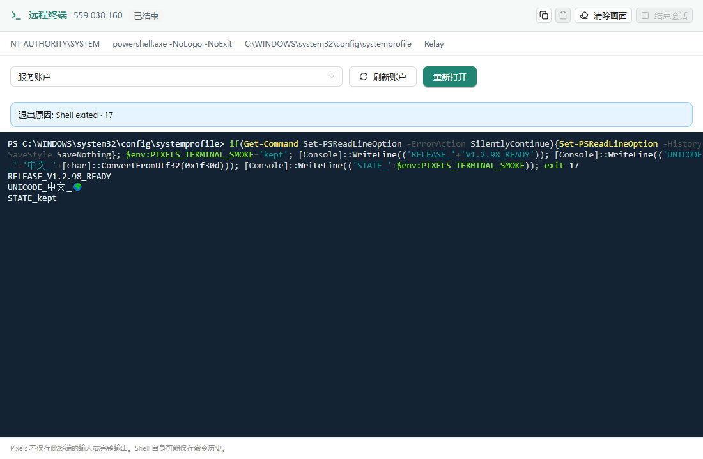
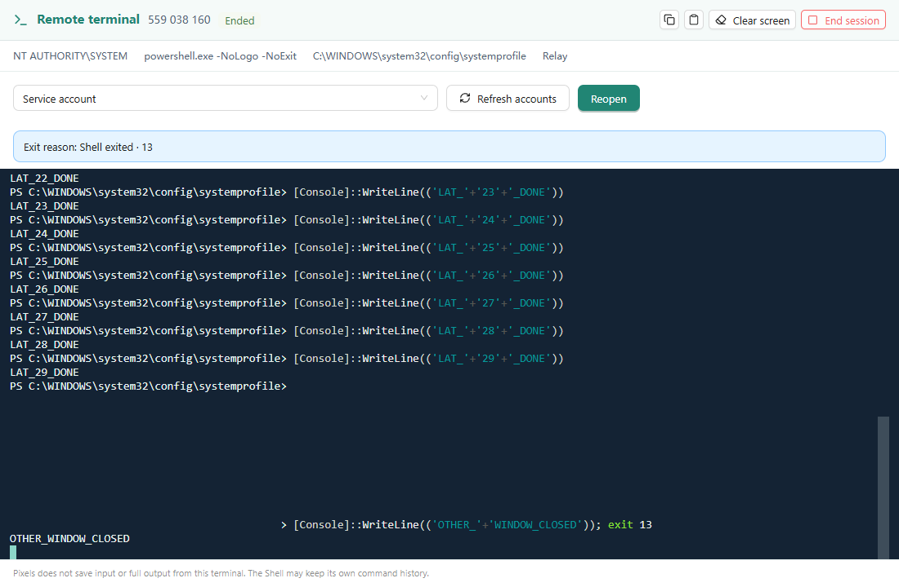

# Desktop 持续远程终端验收

日期：2026-10-14。稳定功能基线：`d22153e`。本次增加设备菜单中的独立终端窗口；不增加或替换 MCP 工具，不迁移既有终端历史。

## 交付与使用

在设备列表的设备菜单选择“打开远程终端”，在独立窗口选择执行账户，再打开 Shell。Windows 使用系统 PowerShell，保留用户配置并设置会话 UTF-8 编码；macOS 使用 zsh，Linux 使用账户 Shell。窗口内当前目录、变量及前台交互程序持续存在。关闭运行中的窗口或结束会话需要确认；取消确认继续使用原 Shell。自然退出后由用户重新打开，不自动重放输入。

同一条已认证设备连接上，新增独立输出流、输入/resize 控制流及关闭请求。渲染消费 ACK 提供 256 KiB 流控；每块输出最多 16 KiB，每次输入最多 4 KiB，输入队列 64 KiB，单次粘贴 256 KiB，xterm 回滚 10,000 行。新会话不写 Pixels 的输入或完整输出归档；Shell 自己的历史设置仍可能保存命令。

## 实际验证

| 范围 | 结果与证据 |
| --- | --- |
| Windows 主验收机器 | XRServer3 `947158375` 为客户端，Company `559038160` 为远端；实际路径 Relay |
| 早期 P2P/Relay 验证 | 切换机器角色前在 90 的隔离 debug Desktop + 安装版 Executor 验证两种路径，分别累计 89,607,538 和 89,665,831 字节，源端与接收端摘要一致；[Direct](early-90-direct.json)、[Relay](early-90-relay.json)。之后停止 90 测试，未安装最后的交付包 |
| 服务账户交互 | 实际 SYSTEM PowerShell：中文、生成的 emoji 输出、变量状态、Ctrl+C 后继续使用同一 Shell、取消关闭、自然退出；约 80 MB 单轮大输出，最终累计 89,144,055 字节，源端/接收端 SHA256 相同；[记录](xr-company-stream.json) |
| 原生用户交互及稳定功能并行 | 实际 `DESKTOP-N3GIEVQ\hy`，WTS session 1。连续 600,902 ms 输出，退出尾部后累计 234,765,124 字节，SHA256 相同；同连接并行稳定 MCP 终端及 12 次命令/文件查询，最大组合耗时 3,586 ms；[记录](xr-company-mixed.json) |
| 窗口权限与交互 | 8 窗口额度，第 9 个拒绝；关闭释放额度；跨窗口销毁主界面及主界面冒用终端命令均拒绝；关闭另一个窗口后原 Shell 继续；resize，30 次输入到标记观察 p95 145 ms；[记录](xr-company-windows.json) |
| 后端回归 | protocol、bridge、executor、os-control、transport、interactive-terminal 共 395 项通过；22 项依赖专用环境的测试在默认回归中忽略，不能视为通过；[统计](test-results.json) |
| 真实专属 worker | 显式指定可抛弃 worker 的 7 项测试通过：身份/版本拒绝、ACK 非法偏移、独立配额、退出尾部、背压下独立关闭、异常控制/账号切换/worker 崩溃/连接丢失，以及大于 256 MiB 的连续输出计数和 SHA256 |
| 界面回归 | 63 项通过，包括 7 项新增终端测试：累计 ACK、resize、取消关闭、粘贴限制、旧会话迟到 ACK、不确定输入不重放、输出缺口后禁止重新激活输入、仅销毁调用者自己的窗口 |
| macOS 原生 PTY | 隔离目录内实际 Darwin arm64 运行 2 项引擎测试：UTF-8 与退出尾部、读取者丢失回收所属 Shell且不结束无关进程。修复 Darwin 对仅剩 zombie 的进程组返回 EPERM 的情况；必须经 native waitid/process 检查确认无存活同组进程才接受 |
| Linux 原生 PTY | 隔离目录内实际 Linux 运行同样 2 项引擎测试，通过 |
| WebView2 | 候选目录排序和不完整版本排除测试通过。90 的系统运行时文件存在而注册缺失；独立副本可通过 SDK 验证后的已安装运行时启动。用户切换测试角色后没有更新 90 安装版 |

全链路字节统计来自有界流式接收器和源端摘要，未将整个大输出保存到内存或结果文件。验收驱动使用同源 debug Desktop 的仅 debug 编译入口观察原生 IPC；Executor 使用实际安装版。正式 release 不包含该调试入口。最后的正式安装与启动复核单独记录于交付结果，不能把 debug 自动化称为 release 的完整 UI 自动化。

## 最终正式版复核

V1.2.98 最终包按 10 个编译任务构建，两台机器覆盖安装退出码均为 0、服务 Running，四个程序文件逐一匹配构建记录。[安装与文件摘要](delivery.json)。安装包统一保存在各机器当前用户 Downloads 的 `PixelsAgentBridge-1.2.98-setup.exe`，未发布到官网/COS。

XRServer 的实际已安装 release `pab-desktop.exe` 使用隔离测试账户数据启动，不设置 debug 参数；确认 39100 没有监听。通过真实设备卡片右键菜单“打开远程终端”进入独立窗口，选择服务账户后连接 Company，看到 SYSTEM 身份、PowerShell 和 Relay。输入合成测试命令，实际显示 `RELEASE_V1.2.98_READY`、`UNICODE_中文_🌍`、`STATE_kept`，自然退出 17 后显示“已结束”及“Shell exited · 17”。随后原生请求关闭，窗口实际消失，主界面仍在；修复了自然退出后远端 NotFound 已转成 BridgeError、导致重复关闭无法完成的问题。该检查通过原生输入、窗口截图和窗口枚举进行，未借助调试 IPC 观察入口；[正式版结果](release-smoke.json)。

## 测试资源清理

XRServer 和 Company 的本轮测试窗口、专属计划任务及 Downloads 下验收目录已移除，V1.2.98 安装包保留在各自 Downloads 根目录，两台服务仍为 Running。90 只移除本轮专属测试目录，没有更新安装或停止服务。Mac/Linux 的隔离临时工具链和构建目录已删除。

本机独立测试 GUI 已结束，多余测试二进制/压缩包和测试账户/设备凭据文件已删除。共享编译缓存保留；少量本机 WebView 测试缓存目录的递归删除被自动安全检查以策略限制拒绝，保留这些目录，没有扩大删除范围。服务器临时测试账户记录保留，不删除真实用户账号或数据。

## 保护边界与实际覆盖限制

- 已有 `crates/terminal`、Executor 的稳定 terminal handler/worker、Bridge 稳定 terminal/runtime/store、Desktop 的 `TerminalBrowser` 和稳定 operator terminal 实现没有代码差异。公共模块只追加注册、能力与新服务启动分支；没有数据库迁移。
- 不确定输入不会自动重放；遇到断连或源端崩溃停止当前会话，清理未确认时保留错误，不能宣称原任务已完成。重新打开是新的 Shell。
- 未开展 24 小时测试。10 分钟样本中 JS 堆受 GC 影响波动，不能据此宣称长期绝无泄漏。
- Windows 的专属 worker 原生 Job 覆盖子进程；Unix 原生 PTY 关闭属于其进程组，不承诺清理主动脱离该组/会话的 daemon。macOS/Linux 本轮是引擎实机验证，未安装并验收完整 Desktop + Bridge + 网络链路，不表述为三平台完整安装验收。
- 系统 PowerShell 5 的旧 PSReadLine 对直接键入 emoji 存在自身限制；中文输入及由程序生成的 Unicode 输出已验证。没有改造已稳定的 Shell 实现。
- 无输入/输出归档验证是在隔离 Pixels 数据目录的数据库、日志与历史文件中搜索本轮合成唯一标记，不代表排除操作系统审计或第三方软件的记录。
- 验收期间使用专属随机测试账户与独立浏览器数据目录，清理本地/远端测试账户凭据文件，不删除真实用户账号或数据。

## 重跑入口

- 后端：`cargo test --locked -j 10 -p pab-protocol -p pab-bridge -p pab-executor -p pab-os-control -p pab-transport -p pab-interactive-terminal`。新关闭回归通过真实 QUIC 错误转换链验证：自然退出后的 NotFound 和重复关闭成功，AccessDenied 仍作为错误返回，共享连接继续可用。
- 真实 worker：先构建 `pab-executor`，设置 `PAB_DESKTOP_TERMINAL_TEST_WORKER` 为其绝对路径，在可抛弃环境运行 `cargo test --locked -j 10 -p pab-executor --lib task_service::desktop_terminal::tests -- --include-ignored`。
- UI：在 `apps/desktop` 运行 `npx playwright test`。
- 原生 UI 驱动：[单会话](../prototypes/desktop-terminal/native-desktop.mjs)、[并行混合任务](../prototypes/desktop-terminal/native-mixed.mjs)、[窗口隔离](../prototypes/desktop-terminal/native-window-check.mjs)。仅在隔离 debug Desktop 设置 `PAB_DESKTOP_TERMINAL_ACCEPTANCE=1`，提供目标设备与自有 fixture；私密凭据只留在原生进程内存或一次性加密交接文件中，不能打印到日志。

所有编译最多 10 个并行任务，不能通过多个同时编译的命令绕过总上限。
