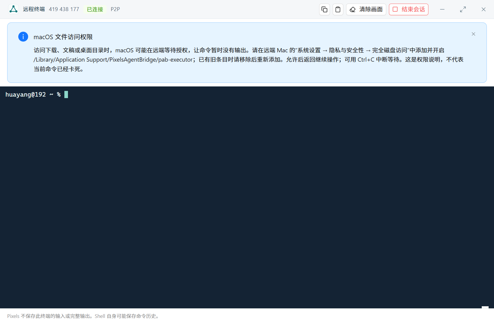

# Linux 远程终端补充验收与 macOS 权限提示

2026-10-15。客户端为本机隔离的原生 debug Desktop，Linux 目标使用 V1.2.99 release Executor。借助仅 debug 开启的观测入口核对实际 PTY 输出与渲染接收摘要；正式安装包不含该入口。本机已安装应用没有被覆盖。

## Linux 结果

- Debian/systemd 安装实例运行在真实 WSL2 Linux 内核上。新版安装、有效在线身份基线下再次覆盖安装均完成；第二次覆盖退出码 0，三个二进制哈希匹配，设备端点及登录凭据保留，服务重新认证。[安装记录](linux-installed.json)、[构建哈希](linux-build.json)。首次覆盖前旧实例已处于 Reconnecting，更新后登记变化，身份保留断言失败；这一次没有计为身份保留通过。
- Windows 原生终端连接 Linux 服务账户和 `pabuser1` UID 23001，分别经过 P2P 与强制 Relay。四个会话各累计约 75 MB，原始源端和客户端逐字节偏移、总量及 SHA-256 一致。UTF-8、emoji、Shell 状态、Ctrl+C 后继续、暂停消费的有界队列、取消结束、尾部与退出码通过。[P2P](linux-p2p.json)、[Relay](linux-relay.json)。
- 云端 Ubuntu 原生 Linux 6.8.0-117-generic：专属临时服务，与正式后端和既有服务隔离。root 与 ubuntu UID 1000 使用真实账户 Shell，分别实际观察到 P2P、Relay；每会话累计约 25 MB。目录、环境、文件读写和原生 UID 归属正确，临时文件已回收。实际 `stty size` 从 40×132 变为 32×107；输出摘要一致，Ctrl+C、取消结束、尾部与退出码通过。[云端结果](linux-ubuntu-native.json)。
- System 菜单模式自动进入 Shell；流式 Shell 运行中，同一客户端执行既有一次性命令并在 206 ms 内得到 Succeeded，原 Shell 继续完成。无本地 console 登录时，普通终端明确提示登录或选择 System，没有暗中切到 root。[并行与入口](linux-ubuntu-parallel.json)。
- Linux 专属 worker 的 7 项测试全部通过，无忽略：非法参数和身份、偏移、独立额度、退出清理、暂停消费下独立关闭、错误控制/账号切换/worker 崩溃/连接丢失、256 MiB 有界接收与源端摘要。Bridge 新终端回归 3 项通过。[统计](tests.json)。

没有进行 24 小时测试，也未验证 Linux 桌面客户端；Linux 此处作为无界面被控端。保持原来已稳定的一次性命令、MCP 终端和其他协议不变。新客户端记录操作系统来自已认证 GetEnvironment，未更改终端线路协议。

## macOS 用户报告的目录等待

Mac 419438177 的系统 TCC 日志确认 `ls` 正在等待 Downloads/Documents 隐私授权，已有完全磁盘访问记录包含旧代码要求，未匹配当前服务程序。用户重新允许访问后，普通用户读取两个目录分别在 22 ms、17 ms 完成；真实网络终端中又重复读取，两者成功并正常退出，尾部及源端摘要一致。[原生结果](mac-permissions.json)。

客户端打开 macOS 终端时显示可关闭的权限说明，写明远端系统设置、服务程序路径以及 Ctrl+C 中断等待；说明不是对当前权限的检测或对卡住原因的自动判断。Windows/Linux 不显示这条 Mac 说明。界面共 16 项回归通过，包含提示出现、关闭后保持输入、新会话恢复提示及平台区别。

新的 Windows V1.2.99 包已生成，位于本机 Downloads；[包哈希与安装状态](client-package.json)、[客户端二进制哈希](client-build.json)。本机未覆盖安装，正在运行的旧窗口还不会显示新说明。没有发布到官网或改变远端 Mac 已安装的服务签名。

本轮隔离 GUI 进程已退出，云端临时服务与传输临时对象已清理；安装实例及安装包保留。本机临时 GUI 目录的递归清理被自动安全检查以策略限制拒绝，保留其缓存与测试副本，没有改用另一种工具删除。低速 SG 传输未完成，未计为 SG 验收；已停止自有下载进程并清理临时目录。私有 COS 对象仅用于尝试传包，未发布版本或修改发布目录，已删除。历史验收数据、正式服务和用户目录不在清理范围。

所有编译最多 10 个并行任务。改动 Rust 文件的格式检查通过；全仓格式检查存在既有差异，没有批量改动无关文件。

## 重跑入口

- [Linux 流式交互与完整性](../prototypes/desktop-terminal/native-linux.mjs)、[System 入口与稳定命令并行](../prototypes/desktop-terminal/native-linux-parallel.mjs)、[Mac 权限提示与实际受保护目录](../prototypes/desktop-terminal/native-mac-privacy.mjs)。仅对独立测试 GUI 启用 `PAB_DESKTOP_TERMINAL_ACCEPTANCE=1`，CDP 仅监听 127.0.0.1:39100；设备凭据经进程内存提供给驱动，不打印、不保存到证据。
- Linux worker：在 Linux 构建环境指定已构建 worker 的绝对路径 `PAB_DESKTOP_TERMINAL_TEST_WORKER`，执行 `cargo test --locked --release -j 10 -p pab-executor --lib task_service::desktop_terminal::tests -- --include-ignored`。
- 前端：在 apps/desktop 执行 `npx playwright test tests/desktop-terminal.spec.ts`。
