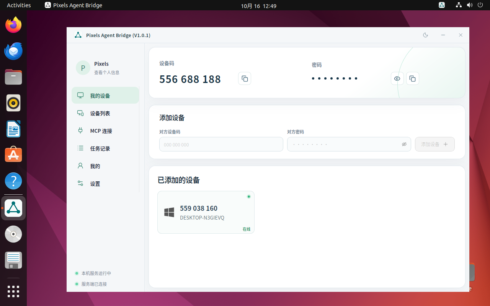

# Ubuntu 登录自启动实机验收

日期：2026-10-16。用户明确授权重启其 Ubuntu 22.04.5 VMware 虚拟机，普通用户 hy，GNOME Wayland，已安装 Linux 桌面 V1.0.1。

## 通过结果

- 将仓库新的 XDG 启动项复制到 `/etc/xdg/autostart/pixels-agent-bridge.desktop`，去掉 `--background`。复制前通过 `desktop-file-validate`，原文件保存在虚拟机 `/var/tmp/pab-autostart-20261016/`。
- 实际重启虚拟机，前后 boot ID 不同。到达 GDM 登录界面时，Executor 服务已自动启动，普通用户的 GUI 尚未运行。
- 使用正常登录界面登录用户后，没有手动执行 Pixels 启动命令，主窗口自动出现。原生 AT-SPI 与 VMware 实际画面均确认可见。
- 恰好一个普通用户 GUI 进程，没有 `--background`，没有 WebView 自动化环境变量。进程的 `GIO_LAUNCHED_DESKTOP_FILE` 明确指向该 XDG 启动项，cgroup 属于 GNOME 登录应用。
- Executor 服务正常，配置文件和设备身份文件 SHA-256 与重启前一致。设备码仍为 556688188；画面显示原账号和已添加的 Company 设备。
- 截图前通过界面隐藏设备密码。登录凭据只在内存及 SSH 标准输入中使用，未写入报告。
- 临时解包的键盘测试依赖已清理，没有安装系统包；输入设备在测试进程退出时销毁。虚拟机保持已登录、Pixels 主窗口正常显示，保留新的可见窗口启动项及原启动项备份。

本次只修改系统启动项，未重新编译、替换二进制或重装 DEB；这验证了新启动项在已有正式 V1.0.1 上的真实登录行为，不代表包含该改动的新 DEB 已发布。其他用户需要后续安装包。

结构化记录：[results.json](results.json)。

