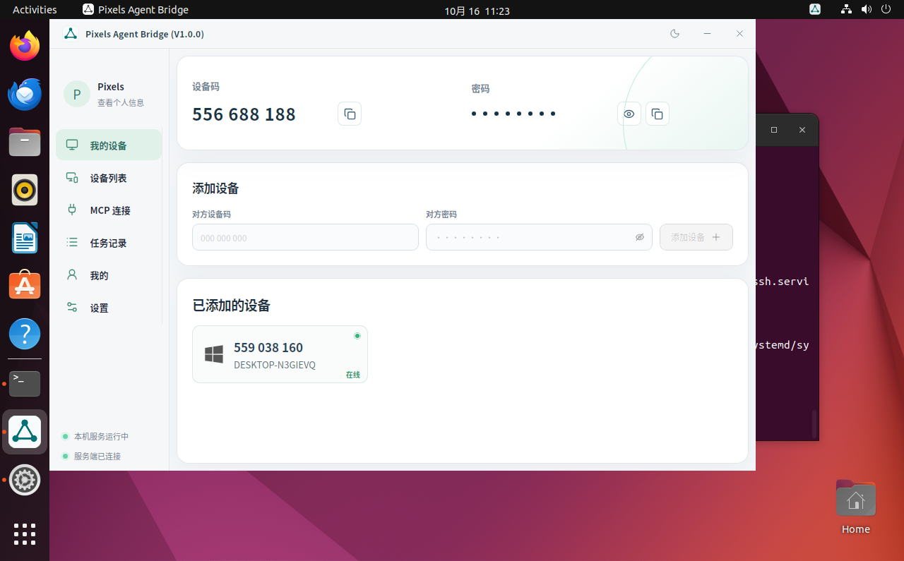
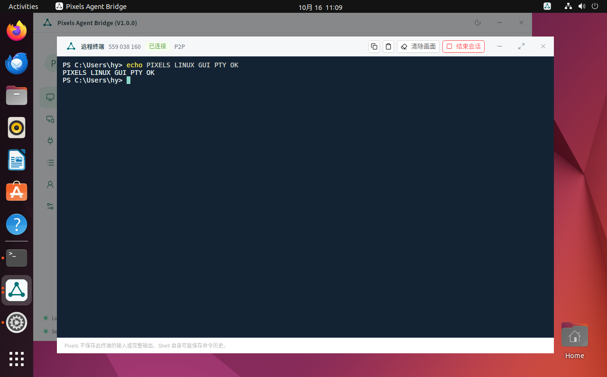

# Linux 桌面版验收

日期：2026-10-16。环境：用户 VMware Player 虚拟机，Ubuntu 22.04.5 x86_64、GNOME Wayland、普通用户 hy。本轮交付原生 React/Tauri GUI 和 deb，未更新本机 Windows 安装，未发布 GUI 到官网或 COS。

## 交付产物

- 桌面包：`pixels-agent-bridge-desktop-linux-x86_64-1.0.0.deb`，64,828,008 字节。
- 包 SHA-256：`202391106df7c6f048ae1f7f90bc97532ecd3a664c4175371d2bd45f47a9ea2a`。
- GUI ELF SHA-256：`0f71ef9bd3dfe60a664c438ceef47b600c368182a9902598406d9f8dda3d472b`。
- 后台直接复用正式 V1.0.2 Linux 无界面包：`15965d7b3a305d9ed97af6bd805eaa2e689fd9a30c93033d9b11061c0a2aef71`，没有重新编译或替换其三个程序。
- 本机产物：`.build/linux-desktop/1.0.0/`；虚拟机安装包：`/home/hy/Downloads/pixels-agent-bridge-desktop-linux-x86_64-1.0.0.deb`。
- 虚拟机设备码：556688188。GUI 标题和关于均为 V1.0.0，后台组件为 V1.0.2，版本关系写入 `desktop-release.toml`。

构建使用 Ubuntu 22.04 独立 sysroot 和 target volume，Cargo 8 + CMake 2，Docker CPU 上限 10。前端类型检查和构建成功，原生 Release 编译成功。工作区仍有未提交内容，`build.json` 中源提交表示基线；上述哈希标识本次实际产物。

## 通过项

| 项目 | 验收证据 |
| --- | --- |
| 安装 | apt 安装成功，动态依赖无缺失；systemd 服务 active/enabled；普通用户的本地访问令牌权限 0600 |
| 真实画面 | VMware VIX 捕获实际桌面，检查主窗口、SVG、图标和布局；不是只检查 DOM |
| 密码显隐 | 显示真实密码与切换隐藏均通过；隐藏为 8 个 6px 圆点，中心间距 16px，无省略号，和显隐按钮垂直居中；报告截图不含密码 |
| 账号 | 在真实 WebKit GTK 窗口通过可见表单登录；退出后重新登录成功，弹窗自动关闭 |
| 设备与远程命令 | 通过可见设备码/密码表单添加 Company 559038160；Ubuntu GUI 提交 Windows `cmd.exe`，收到 `PIXELS_LINUX_GUI_COMMAND_OK` |
| 交互终端 | 独立原生终端窗口自动进入 Company 控制台，经 xterm 输入命令，流式收到 `PIXELS_LINUX_GUI_PTY_OK`，`exit` 正常结束；连接为 P2P |
| 设置 | 通过可见控件切换深浅色和中英文；关于显示桌面安装包版本；Linux 不提供错误的 headless 在线更新 |
| 服务异常 | 停止本机服务后界面显示离线且可操作，服务启动后自动恢复；设备码不变 |
| 窗口恢复 | 关闭主窗口后实际隐藏，从应用菜单再启动恢复原进程；只有一个 GUI 进程 |
| 覆盖安装 | 使用 apt `--reinstall` 实际覆盖同版本，TOML 内容、设备身份、密钥和密码摘要均保持；账号、Company 设备和语言恢复 |
| 卸载重装 | 卸载移除程序、CLI、菜单、自启动与活动服务；配置和设备数据保留；重装后身份、账号、已添加设备、设置恢复 |
| 启动入口 | 修复 Windows 打包引入的无后缀 CLI 脚本 CRLF；最终包从 `/usr/bin/pixels-agent-bridge --background` 正常启动，初始隐藏，再从应用菜单恢复同一进程 |
| 最终完整性 | 最终安装包哈希匹配，已安装 ELF 哈希匹配，`dpkg --verify pixels-agent-bridge` 无差异；启动脚本均为 LF |
| 打包拒绝 | GUI 构建记录正常接受；错误版本、篡改 ELF、缺少记录均被拒绝；后端哈希不匹配被拒绝 |
| 单实例单元测试 | 重复启动通知原实例、崩溃遗留 socket 后重启恢复：1 项通过 |

结构化证据见 [results.json](results.json)，GUI 编译记录见 [build.json](build.json)。交互终端验收后只修改了密码隐藏布局；最终包使用相同终端实现。最终 CLI 换行修复仅重打包，GUI ELF 未改变。

## 运行问题与修复

Ubuntu 22.04 自带的 PipeWire 0.3.48 头文件缺少新版 libspa raw-video flags 字段。GUI 的独立 Cargo patch 使用锁定的 MIT libspa 0.9.2 源码检测实际头文件，兼容原布局；不替换系统头文件，不向稳定 headless 工作空间注入此 patch。

VMware 的 Wayland/WebKitGTK DMABUF 呈现路径出现黑块和错误 SVG。安装启动器仅在 VMware 环境默认设置 `WEBKIT_DISABLE_DMABUF_RENDERER=1`，尊重用户显式环境变量。实际桌面截图已确认正常，最终普通运行进程的环境也已验证；并非只给验收工具加参数。

原生窗口用 WebKitWebDriver 验证真实前端与 Tauri IPC，实际画面通过 VMware Tools/VIX 捕获。验收结束已停止 WebDriver 及其 GUI 子进程，恢复临时修改的 GNOME 空闲设置，使用普通启动器重新打开 Pixels，未留下 WebView 自动化开关。后台和 GUI 保持正常运行。

## 本轮边界

- GUI 首个实测系统为 Ubuntu 22.04.5 x86_64。其他发行版、X11、ARM 和本机 Wayland 截屏/输入不属于本轮通过项。
- Linux GUI 当前使用新版 deb 覆盖升级，尚无 GUI 专用官网发布/自动更新链路。已发布的无界面 V1.0.2 与官网一行安装不变。
- 系统登录自启动入口已安装，`--background` 行为已实测；没有为测试注销、重启用户的虚拟机。
- 本轮没有重新安装或验收 Windows/macOS 产品。密码圆点改动属于共用前端，但本次只在 Ubuntu 真实窗口验证。
- 密码、登录令牌和 SSH 凭据均不进入本记录。测试没有使用 90，也没有修改 Company 上的已有文件。

## 实际画面

普通启动、已隐藏密码的主窗口：

Ubuntu 操作端连接 Company 的远程终端：

