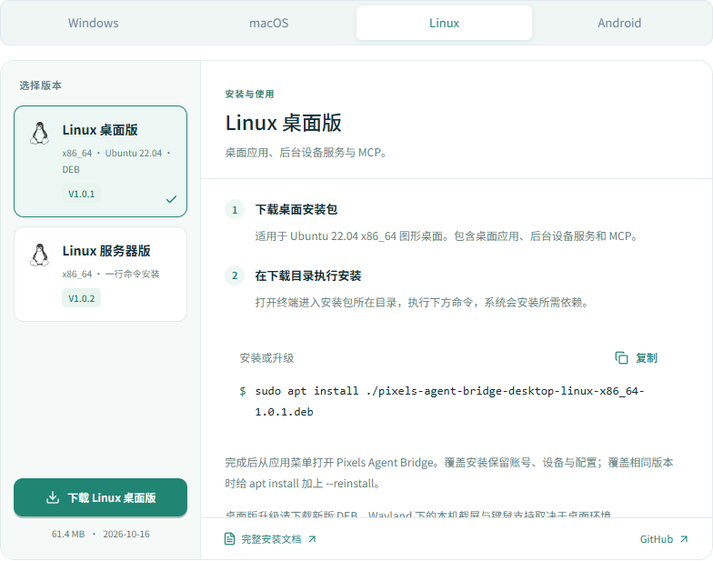
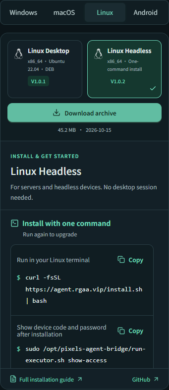
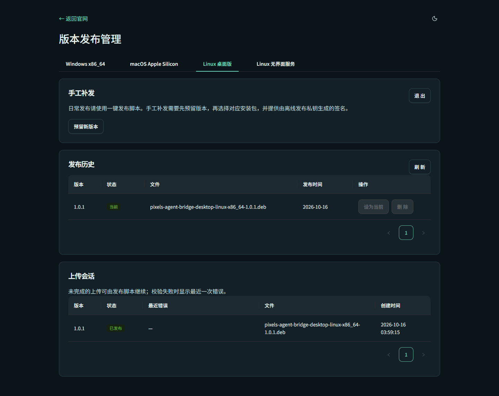

# Linux 桌面正式发布与官网下载区验收

日期：2026-10-16。官网：[https://agent.rgaa.vip/#downloads](https://agent.rgaa.vip/#downloads)。

## 已交付

- 官网下载区改为固定面板。桌面宽度下为版本列表和安装说明两栏；手机下为上下两区。切换平台、架构、语言和长说明时外层高度不变，说明区独立滚动。
- Windows、macOS Apple Silicon / Intel、Linux 桌面版 / 服务器版、Android 都有明确入口与状态；未发布的安装包禁用下载。
- Linux 桌面版独立使用 `linux-desktop-x86_64-stable`，服务器仍使用 `linux-x86_64-stable`。下载、预留版本、签名、上传、历史管理和文件类型分别处理，现有服务器一行安装不变。
- 主仓库 `scripts/release.py linux-desktop` 完成预留版本、构建与记录核验、Ed25519 签名、直传 COS、官网完整校验和 finalize。本次没有直接修改生产发布数据库来发布文件。
- 官网中英文 Linux 桌面安装/覆盖升级说明已更新，并通过 `docs:sync` / `docs:check` 同步主仓库指南。

## 正式产物

版本 **V1.0.1**，Ubuntu 22.04 x86_64 桌面包：

`pixels-agent-bridge-desktop-linux-x86_64-1.0.1.deb`

- 大小：64,402,302 字节。
- SHA-256：`2b62688e1809f03aaa3290663edd9cd70f9b354db7572bf0b44f2a5acc7ab6a0`。
- 已安装 GUI ELF：`2147c6b674342ba1c94f1c3df1db7e991c46dfe247d57b5182f4e0ce077b6095`。
- 后台组件继续使用已验证的 V1.0.2 包，来源哈希见 [package.json](package.json)。
- 正式构建来自独立干净 worktree 的提交 `3f3d0e0f2bda7b289ed63eabbc161fd0778e86c5`。构建和发布没有改动主工作区 HEAD、索引及其他会话的修改；该提交保留在本仓库对象库和发布 worktree 中，未声称已经推送 GitHub。
- 实际文件与签名见 [published.json](published.json)，构建版本与 GUI 哈希见 [build.json](build.json)。

下载入口：[/downloads/linux-desktop-x86_64](https://agent.rgaa.vip/downloads/linux-desktop-x86_64)。该入口跳转 COS 对象，文件名、内容大小、签名和哈希已核验。

## 验收结果

| 项目 | 结果 |
| --- | --- |
| 官网后端 | Cargo 8 + CMake 2，8 项 HTTP 测试通过；覆盖 Linux 桌面/服务器目标隔离、独立版本、目录和下载/API、错误包名和错误架构拒绝 |
| 发布输入 | 5 项 Python 测试通过：正确产物接受，DEB 篡改、GUI 篡改、错误目标、缺失构建记录拒绝 |
| 固定布局 | 6 项下载专项测试在本地与线上均通过；320 / 375 / 768 / 1440px，中英文，平台/架构切换高度稳定；长版本说明滚动、加载错误与重试均保持面板尺寸 |
| 管理页面 | 3 项回归通过：桌面与服务器分别预留目标/接受 DEB 或 tar.gz，切换清理旧表单，历史删除/当前版本保护继续有效 |
| 真实官网 | 未模拟发布数据时检查真实 V1.0.1 下载和安装命令；Range 返回 206 且 DEB 头为 `!<arch>`，Content-Disposition 文件名正确，无页面脚本错误 |
| 真实后台 | 使用真实管理员会话只读检查 Linux 桌面标签，发布历史显示 V1.0.1 为当前，上传会话为已发布 |
| 文档 | 官网中英文说明可见；`npm --prefix web run docs:check` 通过 |
| 原有页面 | 首页、主题/语言、手机导航、文档入口回归通过。预览服务器的旧格式 COS 下载地址导致首页 Range 项返回 403，随后在真实官网重测该项通过，未将预览配置的结果作为下载验收 |
| 官网部署 | 新镜像 `pixels-agent-bridge-site:linux-desktop-downloads-20261016`；保留 TOML 与持久数据卷，发布数据库在替换前已备份，HTTP health 与公开安装脚本检查通过 |
| 原有版本 | 与部署前数据库备份比对，Windows V1.3.4、macOS V1.2.71、Linux 服务器 V1.0.2 的当前发布均保持，只有 Linux Desktop 新增 V1.0.1 |
| 官网完整下载 | Ubuntu VM 直接通过官网下载入口下载完整 DEB，签名、文件大小与 SHA-256 验证通过 |
| 真实覆盖升级 | Ubuntu 从 V1.0.0 覆盖安装到 V1.0.1，TOML 原始内容、设备身份/密钥/密码摘要不变；设备码仍为 556688188，账号和已添加 Company 恢复 |
| 升级后运行 | 原生 GUI 标题 V1.0.1，本机服务运行；Company 保存连接可重新使用，远程命令返回 `PIXELS_LINUX_DESKTOP_PUBLIC_RELEASE_OK` |
| 收尾 | 停止验收辅助进程，恢复 GNOME 空闲设置；Ubuntu 保持普通运行的 Pixels 与系统服务，不带 WebView 自动化开关；本机 Windows 未更新 |

具体证据：[线上结果](live-results.json)、[覆盖升级](ubuntu-upgrade-results.json)、[原版本保留](deployment-preservation.json)、[虚拟机最终状态](vm-final-state.json)。

GUI 当前通过下载新版 DEB 覆盖升级，不宣称已接入在线自动安装；本机 Wayland 截屏/输入及其他 Linux 发行版的覆盖范围沿用 [首轮桌面验收](../linux-desktop-2026-10-16/README.md)。

## 实际线上画面

Linux 两种版本和对应安装说明：

手机深色英文布局：

真实后台的桌面发布记录：

